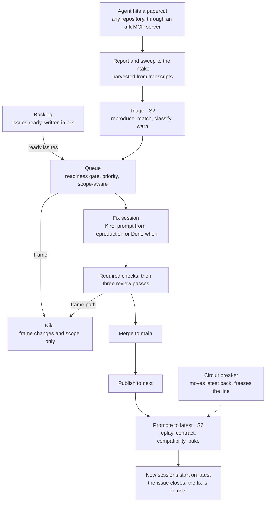

# Factory: Design Doc

Nov 18, 2026 · drafted by Claude for @Niko Virtala · revised Nov 23, 2026 after a review against draft's model and the deployment package

## Context

The factory turns ark into a product that works its own issues: a papercut an agent hits is fixed and in use before a second agent hits it, the ready backlog drains in between, and Niko reviews only changes to the frame. This doc lives in ark (`docs/05-factory-v1.md`) because ark is the product; how generic it becomes is left to time.

**Where it comes from.** On 17–18 November 2026, Claude in chat drove about 11 Kiro sessions across longplay and kiro-remote through kiro-remote's MCP. kiro-remote already gives each session its own sandbox, links each pull request to its session and tells the session about conflicts. Branch protection, auto-merge, ADRs as guardrails and read-only AWS access were in place. What still needed a person sat *between* the steps:

- **Choosing work.** The plan knew what was unblocked; a chat session picked tasks and wrote prompts by hand.
- **Reviewing.** Every pull request was read in chat before merge. It rarely caught a defect; it caught conflicting and stale docs and instructions.
- **Closing the loop.** Tasks 2.1 and 3.1 were merged but never marked done.

All three are state held in prose or in someone's head. ark exists to make that state structured and accountable, and it already has the parts: issues for work (with `depends-on`, `issues ready` and a bug template with Steps to reproduce, Expected, Actual and Done when), adr for guardrails, and lessons planned for what agents learn.

**What ark already does.** `release.yml` publishes changed packages with Changesets and npm trusted publishing (OIDC, provenance) on every push to `main`. Consumers pin exact versions in their MCP configs (R4 in [03-setup](03-setup-v1.md)), and ark runs its own tooling from the previous release, bumped by the `self-update` job in a pull request.

## Problem

> Every papercut an agent hits in ark is fixed and in use before another agent hits it, ready backlog issues flow in the capacity left over, Niko is in the path only for changes to the frame, and faster delivery does not speed up rot.

**A papercut is an outbreak.** Each agent that hits it is a case. The aim is containment before the second case, so the measure is hits per papercut and the time from first hit to a fix in use. The customers are agents, most of them working in other repositories (longplay, kiro-remote) through ark's MCP servers.

**The backlog waits.** On 18 November 2026, 28 issues were ready in ark's own log, most of them tests, refactors and review follow-ups. They need no detection, only someone to pick them up, and today that is a person.

**Rot, not bugs.** Hand review rarely found defects. It found drift: docs and instructions that conflict or go stale. Drift is global (a clean diff can make another doc wrong), grows with throughput, and feeds itself, because the next session reads those docs as instructions.

**The frame.** A change is *routine* when it works inside the frame and *dramatic* when it changes it. The frame is ark's ADRs, the plan's scope, `AGENTS.md`, the factory's own guardrails (branch protection, CI, the reviewer's rubric) and anything that can't be undone, such as event formats. The test: would Niko be surprised to learn of it afterwards?

**Why now.** Throughput is the current priority, and the limit was never the Kiro sessions. It was whatever passed one at a time through Niko or a chat session.

## Goals and non-goals

**Goals**

- A papercut hit in any repository reaches ark's issue log as a reproducible report, without a person relaying it.
- A reproduced papercut is fixed, reviewed, released and picked up by new sessions with no human click, within one agent task (hours).
- Ready backlog issues inside the frame are dispatched, fixed and closed with no human click, in the capacity papercuts leave free.
- Running sessions learn that an issue is known, and which calls to avoid, before they hit it again.
- Niko reviews frame changes only; routine fixes flow.
- A bad release is detected and rolled back by itself, and the line freezes until Niko resets it.
- An issue closes when its fix is in use, not when it merges.

**Non-goals**

- Deciding scope without Niko. The factory proposes a Done when, a scope or a split for vague issues; changing scope stays his.
- Making the factory generic in v1. It is built for ark, with the seams kept for a second project (see Generality).
- Exact reproducibility of the tool version a session runs. Losing exact pins is acceptable for a trusted tool; reports record the version instead.
- Fixing papercuts in the reporting session itself. That session keeps its version; the fix serves the next one.

## Overview

Two intakes feed one line: papercuts through triage, the backlog through `issues ready`, both into one queue. Two links are gates: a report becomes work only by reproducing, and a release reaches every agent only after replay, contract, compatibility and bake.

Niko sits beside the chain, not in it: a frame label from triage or the queue, and the frame paths in `CODEOWNERS` are the only ways a change reaches him. It reaches him in draft, as an acceptance request with the reviewer's verdict as its evidence, rather than in GitHub's review screen: draft accepts as Niko, with his identity and signing key, shows what waits on him on its map, and records each settlement as a fact ([draft: Acceptance](https://github.com/nikovirtala/draft/blob/main/docs/model.md#acceptance)). The breaker watches the release end and can move `latest` back.

## The factory's state is data

Every link of the line is a kind in ark's ledger: states, an actor who can close it, and a timeout that says what happens when nobody does. The factory keeps no state that only one reader can see (9t6n5jc6): nothing only in GitHub labels or `factory.toml`, and kiro-remote keeps its operational state, pull request links and waits, only because it publishes every change to them, and every wake with its reason, on its change feed. The dispatcher, the breaker and any dashboard read the same log, and draft's map draws the whole line from it ([draft: The map](https://github.com/nikovirtala/draft/blob/main/docs/model.md#the-map)).

| Kind | States | Closed by | Timeout |
| --- | --- | --- | --- |
| Report | received → reproduced or parked → matched or filed | Triage | Parked for 14 days: declined with its reason, recorded as a fact |
| Dispatch | queued → running → pull request open, or abandoned | The dispatcher; the session | No pull request after 4 hours: abandoned, the issue back in the queue |
| Review | requested → approved, or changes requested (rounds 1–3) → frame | The reviewer App | 3 rounds, or 2 hours without a verdict: frame, to Niko |
| Release | published to `next` → baking → on `latest`, or rolled back | The promote job; the breaker | A bake that can't finish in 72 hours: held, to Niko |
| Person's check | requested → passed or failed | Niko | 7 days: reminds him; the issue stays open |
| Design | proposed → accepted, or changes asked | Niko | 7 days: reminds him; work that depends on it waits |
| Breaker | open → reset | Niko only | Daily: reminds Niko. It never resets itself, so it fails closed |

**The frame label is a projection.** The frame label this doc puts on issues and pull requests is written from a ledger fact (a Report or Review that reached frame, a frame path touched), so people see it where they work. No reader decides from the label; each reads the fact.

**One source per question about a release.** Which version is on `latest` is a fact two places record: npm's dist-tag, which every consumer resolves, and the Release kind, which keeps its history. For what is live, the dist-tag is the source: the promote job and the breaker read it, and never the ledger. For what happened, the Release kind is: measures and draft's map read it. A reconciliation check compares the two after every promotion and rollback and once a day, and a mismatch blocks promotion until it is explained. This is the 22 November drill below, closed by rule rather than by care.

Two rules follow. A measure is a fold over these kinds, not a counter kept beside them: hits per papercut, time to `latest`, reviewer agreement and frame-lane volume are queries, walks over draft's graph of the line (see One graph of the line). And a reader folds a kind's history instead of trusting the newest status written somewhere else. On 22 November 2026 a drill on kiro-remote's pipeline left its GitHub deployment at `failure` after the rollback and a later successful deploy, while the run ledger knew it was over.

A step only a person can do (a check on Niko's Mac, a second Apple account, a secret only he has) is a kind too, with its steps written out in full, each with what he should see. An issue whose last Done when is such a check closes when the check passes.

A design is accepted from visual examples before code is written. Its tokens and previews are committed (draft's `docs/design-system`, 23 November 2026) and become standing: the single source the code is generated from or checked against, with a test that fails when a value drifts. Work that depends on a design waits for its acceptance, and the Done when pass compares a UI change's screenshots with the accepted previews.

The numbers in the timeouts are starting values, kept in `factory.toml` with the rest.

## One graph of the line

**The person's questions about the line.** The measures below, and the questions a person asks about the line, are walks along causes across systems. What led to this rollback? Where did this papercut's fix wait on its way to `latest`? How many wakes were done by hand this week? Which decisions rest on an assumption that was contradicted this month? A papercut's chain runs from a report in kiro-remote's intake to an issue in ark's ledger, a dispatch, a session's pull request on GitHub, a review, a release on `next`, the promotion to `latest` and the next session's calls. No tool holds the chain; each publishes its part (9t6n5jc6).

**No new system answers them.** The factory is not a product with its own runtime: its capabilities sit in the tools where they apply (see Generality). The tool that already reads every source of the line for the person, the ark ledgers, kiro-remote's change feed, pull requests, checks and deployments, is draft, and the person's lane is there. So draft keeps one graph of everything it reads, across the person's contexts, as an edges table in SQLite, and each measure is a named query over it (draft's tmgcgdj8). Anything that runs unattended (the dispatcher, the breaker, the promote gate) reads its own source and never this projection, as a reader folds a kind's history rather than trusting a copy.

**Causes are recorded where things happen.** What the line lacks is not a store but causes. Every event in every published log names what caused it, as addresses of other events: ledger events gain an optional `causes` field in the envelope (6wh6egkw; an added field is already safe both ways, see Event format compatibility), kiro-remote's change feed already names a wake's cause and its pull request, a commit names the issue it closes by trailer, and a deployment names its commit. What a person or an agent does is a command with its actor, apart from the states it causes (draft's p6hx9jdv). No reader infers a cause from timing or similarity (draft's cqwg12zy): an event whose source records none says its cause is unknown, and the share of unknown causes is itself a measure of how well the line can explain itself.

**Causes are claims.** A cause is what its writer was given and passed on; `verify` checks that an address is well-formed and that a ledger address exists, not that it names the real cause (noted on 6wh6egkw). A measure built on agent-written causes is only as good as those agents, which is one more reason no unattended reader decides from the graph.

**Walks keep the trust boundary.** A walk from an issue back along causes reaches the report that started it, and that report's text is untrusted (see Triage and the trust boundary). Today only people and measures walk the graph. Any agent step that follows causes (Learn in step 6, a wider drift pass) carries addresses and reads through them under the same rule as triage: only a reproduction, or text a person accepted, reaches its prompt.

**Measures are walks.** Each measure in Pilot and decisions is a query over draft's graph, not a counter kept beside it. A few, with the walk that answers them:

| Measure | The walk |
| --- | --- |
| Hits per papercut | Reports with a `matched` edge to one issue, counted per issue |
| First hit to fix on `latest` | From an issue's first report forward along causes to the release that put its fix on `latest`: the time between, and the longest step on the path, which is where it waited |
| Wakes done by hand | Session turns whose cause is a person's command rather than a kiro-remote wake |
| Items left for a person per pull request | Person's checks caused by a merged pull request |
| Open ends | Effects that led nowhere within their kind's timeout: a lost prompt, an abandoned dispatch, a check never answered |
| Decisions resting on a contradiction | From a fact that contradicts an assumption, back along `rests-on` to the decisions that cite it |

## Detection and intake

Papercuts reach ark through two channels into one inbox: agents report them as they happen, and a sweep finds the ones they worked around in silence.

**The report tool.** Every ark MCP server gains, from ledger, a `report` tool. When to call it is written in the server's own instructions and the tool description, not in `AGENTS.md`, so the rule ships with the version and cannot rot on its own. Those strings are prompts every consuming agent reads, so they live apart from code: each package keeps its server instructions, every tool and argument description and the known-issue line template in one prompts file, a frame path (see Frame routing). A report is structured:

| Field | Content |
| --- | --- |
| `tool`, `version` | the MCP tool called and the package version actually running |
| `arguments` | the call as made |
| `output` | what came back, kept as an opaque blob |
| `expected` | one line on what the agent expected |
| `workaround` | what the agent did instead, if anything |
| `note` | short free text from the agent; never passed to a prompt as written |
| `session` | added by the intake from the session it harvested the call from, never taken from the report |

**The intake harvests reports; the sandbox holds no credential.** The `report` tool makes no network call: it validates the report against its schema and returns. kiro-remote already follows each session's events and transcript, so the intake reads `report` calls from there, and the session that made a call is known without the sandbox proving anything. An agent working in longplay cannot write to ark's git-backed issue log, so this is what makes reporting cross-repo. The intake lives in kiro-remote, keeps a per-session limit, and kiro-remote's auth facade still mints no tokens.

**Local sessions.** A session outside kiro-remote (Claude Code on Niko's Mac) leaves no transcript to harvest. There the `report` tool appends the report to a local queue file, and a session-end hook posts the queue to a new kiro-remote endpoint under Niko's own OAuth, from his machine and never from a sandbox.

**The sweep.** After a session ends, a sweep reads its transcript through kiro-remote and files reports for what the agent did not report: ark tool errors, retried calls, and work done around a tool (editing ledger files by hand, say). The sweep has one permission, writing to the intake. Its findings also measure how much self-reporting misses.

**Friction counts too.** Many papercuts are a tool that works as designed and still trips agents up: invalid arguments, retries, the wrong tool picked. These rarely reproduce as a bug. The sweep counts tool errors, retries and redundant calls per tool and version, and a rising rate opens a *friction* issue. Its fix (a clearer description, an actionable error, a changed argument) is proven by an eval task, not a reproduction: a scripted agent does the job, and its error rate must fall. A fix that changes a description touches the prompts file, so it is a frame change until the pilot shows those strings can flow.

**Known issues travel back.** Triage publishes a public known-issues list per package and version. Each MCP server reads it at start, with no credential, and adds a line to a matching tool response. Agents in every session, cloud or local, learn about a papercut before they hit it.

The line is a template filled from fields, never free text: the issue id, the tool, the argument shape that triggers it, and its status ("fix pending", or the version that fixes it), headed by the id of the triage run that wrote it, for example `known issue ?42 (triage run …): issues_update with an empty labels list fails; fix pending`. Reproduction proves the bug exists, not that a workaround is benign, and a workaround triage wrote is agent text read from a report. So a free-text workaround reaches the line only from an issue a person accepted (see Trust attaches at acceptance); until then the line names only what to avoid. The template lives in the prompts file, so changing it is a frame change.

## Triage and the trust boundary

Only a reproduction crosses from a report into ark's work. Reports come from agents that have read arbitrary data, such as Last.fm tags and artist bios in longplay, so a report is a channel for prompt injection into a pipeline that ends in a tool every agent runs.

**The chain to break.** Injected text in a report → an issue → a Kiro session with write access to ark → an LLM reviewer reading the same content → auto-merge → `latest` → every session in every project. The sweep is exposed in the same way, since transcripts hold everything the agents read.

**Triage, step by step.**

1. **Reproduce.** Call the tool with the report's `version` and `arguments` in a clean sandbox and confirm the output differs from `expected`. No reproduction means no automatic fix: the report is parked for Niko. Friction reports skip this step and go to the eval set instead.
2. **Match.** Compare the reproduction with open issues. A match adds a hit to that issue; when unsure, open a new issue, because merging two is cheap and a hidden bug keeps spreading.
3. **Write the issue** from the bug template: Steps to reproduce, Expected, Actual, Done when ("the reproduction passes on `latest`"). The reproduction itself is data, not prose: the call, the version and the expected output, attached to the issue. The text is triage's own; the reporter's `note` is summarised, never pasted.
4. **Classify** the issue as routine or frame (see Fix and review). Frame issues get a label and wait for Niko.
5. **Warn** running sessions that use the tool, through kiro-remote's prompt to a running session: the same templated line as in the tool responses, never free text.

The same step filters honest mistakes: an agent that blames the tool for its own error produces no reproduction.

**Trust attaches at acceptance.** Every ledger event records its `actor`, a person or an agent, and on whose behalf an agent wrote (`ARK_AGENT` and `ARK_ON_BEHALF_OF`). Text an agent wrote is untrusted until a person accepts it: an issue opened or rewritten by triage, shaping, the reviewer, a Kiro session or Claude in chat on Niko's behalf reaches a fix prompt only through its reproduction or a Done when that triage checked, and its prose only as a summary. Once Niko accepts the pull request that adds it, as himself and signed, through draft's acceptance or GitHub's review, it is trusted: a person read it and stood behind it. A rule keyed on the author alone would empty the backlog, since on 22 November 2026 almost every new issue in ark and draft was written by an agent on Niko's behalf. The signature has to outlive the merge: Rebase and merge rewrites commits without their signatures, so the signed originals are recorded at acceptance (draft issue r7s5es9e). Without this rule, an injection that reaches triage would be laundered into the trusted backlog, the multi-agent trust escalation Anthropic warns about. teyqf2j9 (accepted) says this, replacing 50gsp714.

**Canary strings.** Triage plants a unique marker in each issue it writes. A required check and the sweep flag any commit, pull request or report where a marker turns up outside its own issue: text is travelling between agents where it should not.

**Least privilege.** The sweep writes to the intake only. Triage writes issues and sends warnings, and cannot touch code. The fix session gets a prompt built from the reproduction and the issue, never from a report, and runs with no credentials beyond its own pull request.

**Triage as a Kiro workflow.** Triage can run as a saved [Kiro workflow](https://kiro.dev/docs/workflows/) recipe, where each step is its own agent in a fresh session and steps pass results only through declared handoffs. Only the reproduce step reads the raw report; the steps after it see only the reproduction artifact, validated against its schema first, because handoff values arrive as plain text. Each step's tools are narrowed with `tools` and `excludedTools`, and the most restrictive permission wins. The runtime then enforces "only the reproduction crosses" instead of the prompt.

## Two intakes, one line

Papercuts and the backlog feed the same line: from dispatch onwards nothing depends on where an issue came from. Papercuts arrive reproduced and jump the queue; the backlog arrives through `issues ready` and must pass a readiness gate first.

**The backlog is trusted where a person accepted it.** An issue is trusted once a person has accepted the pull request that adds it, whoever wrote it. An issue an agent opened or rewrote after that acceptance is not, whichever intake it came through (see Triage). Both kinds may be too vague to finish against.

**Readiness gate.** An issue enters the queue when all of these hold:

- `issues ready` lists it: no open `depends-on`;
- its Done when is checkable, ideally as tests;
- it has a `scoped` set of globs;
- it sits inside the frame.

**Shaping.** An issue that fails the gate goes to a shaping session, which proposes a sharper Done when, a scope, or a split into smaller issues. Sharpening flows; changing scope is gated behind `mcp can-decide` by the existing ADR "Gate agents deciding and rescoping behind MCP can-decide", so it reaches Niko.

**Inside the frame by link.** An issue that `implements` an accepted ADR, or a design doc in `docs/`, is inside the frame: the decision is made, carrying it out is routine. An issue whose work *is* a decision, such as recording one, is a frame change. Features with neither link are frame by default. The link is also what the Done when pass reads: on 22 November 2026 a map pull request in draft met its prompt to the letter and missed the design's intent, because the prompt named fewer kinds than the design did.

**Queue.**

1. Breaker issues.
2. Papercuts, by hits.
3. The backlog, by priority label, then age.

A limit on concurrent sessions caps the line; the backlog fills whatever papercuts leave free. The dispatcher groups issues that touch the same files into one session, and runs sessions in parallel when each owns its files: the prompt names the other sessions and what they own, a session rebases when `main` moves, and kiro-remote wakes it on a conflict. Work that needs another pull request first waits for it: kiro-remote wakes a session when a pull request it waits for merges, a wait registered at launch or by a `Kiro-Remote-Waits-For` line in the session's own pull request. On 23 November 2026 three draft sessions ran this way, on the window's layout, its colours and the map, and met only in one stylesheet.

**Done.** An issue that ships code closes when its fix is on `latest`. Test-only and internal changes publish nothing (Changesets releases only changed packages), so they close at merge.

**The backlog on 18 November 2026, sorted by title.** A finding from that day, kept as history: the issues have moved since, so the dispatcher sorts the live `issues ready` output, never this table.

| Lane | Issues | About |
| --- | --- | --- |
| Routine now: tests, refactors, small fixes | ?1, ?45, ?48–?57, ?66, ?67, ?68, ?71, ?72 | 17 |
| Routine once linked to an accepted ADR or design | ?60, ?62, ?63, ?64 | 4 |
| Features: shaping, then Niko | ?69, ?70, ?73, ?74, ?75 | 5 |
| A decision to record: frame | ?83 | 1 |
| Needs a person in a real session | ?82 | 1 |

## Fix and review

A routine fix merges when deterministic required checks pass and an isolated reviewer approves; a frame change waits for Niko, and GitHub enforces the difference. Checks decide everything that can be decided mechanically, because the reviewer reads agent-written code and can be steered by it.

**Dispatch.** A dispatcher takes the next issue from the queue (see Two intakes, one line) and launches a Kiro session for it through kiro-remote. The prompt is built from the issue: for a papercut the reproduction becomes the first test, for a backlog issue its Done when does. Fix sessions run at Kiro's "common dependencies" network level, never open internet, and the session's pull request is linked to it, so review comments and conflicts reach the same session. The session proves its work before it asks for review: it waits for CI, reads the results and artifacts (logs, screenshots) itself, and fixes what fails; "CI runs them" is never a reason to hand a check to a person. What it cannot prove becomes a Person's check, each item with the reason no test can show it, and a kind of check that keeps landing there becomes a required check or an issue.

**The reviewer** is a GitHub App with its own identity, so its approval counts as a separate review and an author session can never approve its own pull request. The Done when and drift passes run on the strongest Claude model, a tier above the author; the security pass runs on another vendor's model, so reviewer and author do not share blind spots. Models are set per pass in `factory.toml`. The reviewer is not hardened against prompt injection, so it is never the only gate on anything a check could decide. Any pass that finds a problem blocks:

- **Done when:** the issue's Done when is met by what the code does, not only by passing tests, and in the spirit of the design section the issue implements, which the pass reads too; for a UI change, also against the accepted design's previews;
- **Drift:** does this pull request make any other doc, skill, server instruction or template wrong? This is the check for rot. It reads beyond the diff, but not blindly (see Drift, deterministic first);
- **Security:** new attack surface the checks cannot see, such as a tool that now writes outside its log.

**Drift, deterministic first.** Drift is the most valuable pass and the most exposed one: a model reading beyond the diff reads whatever the diff steered it to. So data chooses the candidates before a model judges them. AGENTS.md, the skills, the server instructions and the docs are imported as standing, each with a scope of globs ([draft: Importing an existing project](https://github.com/nikovirtala/draft/blob/main/docs/model.md#importing-an-existing-project)), the way `adr for <path>` already matches decisions to paths. A diff's paths select the standing whose scope they touch, and the pass judges only those and the docs that cite them. A drift finding is a fitness finding (*contradicted*, *stale*) recorded as a fact, and one that repeats climbs the ladder into a check. This makes the importer a prerequisite of the drift pass: until it has run, drift is read the old way, wider and weaker.

"Request changes" goes back to the author session through the pull request link. After three rounds without approval, the pull request gets the frame label and waits for Niko, so a stuck loop cannot burn sessions quietly.

**The fix as a Kiro workflow.** Inside its session, the fix can run as a saved workflow recipe: implement, run the required checks, then the three review passes as a branch and join, each pass an independent agent on a different model than the author. A loop with `maxIterations` 3 sends findings back to the implement step, and a wait node watches the pull request's checks and review without spending model turns. Most rework then happens before the pull request exists. Two things stay outside the recipe:

- **Approval.** Workflow steps act with the session's own repository credentials, so a review step cannot count as a separate reviewer; the GitHub App still approves. Kiro's bundled pull request pattern does not merge either.
- **Dispatch.** Workflows document no event, schedule or GitHub triggers, so kiro-remote still launches the session and names the recipe to run.

**Recipe rules.** Recipes live in ark's `.kiro/workflows/` and are frame paths in `CODEOWNERS`: a recipe is the factory's process. A step's least privilege goes in its `tools` list: in a Kiro agent, `tools` decides which tools exist, and permission rules only decide what a listed tool may do, so a user-wide allow rule can't bring back a tool the list leaves out ([Kiro: custom agent configuration](https://kiro.dev/docs/custom-agents/configuration-reference/)). The factory runs only saved recipes by name and never a plan Kiro generates for the task, so an injected issue cannot shape its own process. If Kiro asks to approve a plan, kiro-remote approves it only when the plan is the saved recipe from ark's `main`, matched by name and content hash; anything else is denied and goes to Niko. Workflows cost more tokens, so they run for code-changing work: papercut and friction fixes, ADR-linked work and anything touching `src`. Test-only and docs-only items run as a single session. The split is set per lane in `factory.toml`.

**Required checks.** These run in `check` with no model involved. A pull request that fails any of them is not routine and waits for Niko:

- the reproduction under `repro/` matches the issue's byte for byte, and no pull request changes or deletes a file there;
- no test is deleted, skipped or weakened: the test count per package does not fall and no skip is added;
- the diff stays within the papercut limits: at most 100 changed lines and 5 files outside tests, `repro/` and docs, in one package (in ark's last 23 fix commits the median was 24 lines and 2 files, p75 50 lines and 4 files);
- no new dependency, install script, or network or filesystem access (a lint rule on imports and calls);
- no change to the `report` tool, the intake, triage, the reviewer or the checks themselves;
- no `instructions` or `description` string outside a package's prompts file;
- no canary string outside its own issue;
- every test, file and command the pull request's Evidence names exists, and every test it names ran in this commit's CI;
- every item the pull request leaves for a person says why no test can show it;
- every screenshot in the description links a commit and was taken on the pull request's head;
- `AGENTS.md` mechanics: Conventional Commits, linear history, no stacked pull requests.

Every limit in the checks, the queue and the bake lives in `factory.toml` in ark's root. `factory.toml` is standing, not configuration: each value holds until a decision changes it, and carries what standing needs ([draft: Standing](https://github.com/nikovirtala/draft/blob/main/docs/model.md#standing)): the decision behind it, a tripwire that reopens it, its scope and its rung on the ladder. The file is an export of the accepted values, so changing one is a decision through acceptance, never a quiet edit, and always a frame change. Two fitness checks come with it: a value no check or guard reads is *unread*, and a check that never fires is *silent*, perfect or dead, worth asking which.

**Frame routing, deterministic first.** Paths decide before any model does. A `CODEOWNERS` entry names Niko for the frame paths, and branch protection requires a code owner's review, so the App's approval alone cannot merge them:

- `docs/adr/`, `AGENTS.md`, the design docs;
- `.github/`, branch protection settings, all of `.kiro/` and `.claude/` (Kiro loads a workspace's skills, steering and `mcp.json` into every session there, over ACP and in the cloud, not only its workflows), `factory.toml`, the reviewer's rubric and the factory's own code;
- each kind's event schema and ledger's envelope (see Event format compatibility);
- each package's prompts file (`packages/*/src/mcp/prompts.ts`): the server instructions, every tool and argument description and the known-issue line template, which every consuming agent reads as a prompt.

A path only gates what lives in it, so a required check fails any `instructions` or `description` string written outside the prompts file. Result texts and error messages stay in code: they are mostly templates around data, and the reviewer and the drift pass read them, but no path gates them (see Seams and risks).

For everything else the reviewer judges, and when unsure it adds the frame label. This keeps the existing ADR "Gate agents deciding and rescoping behind MCP can-decide": an agent may fix, but not decide.

## Release channels and promotion

A fix is published to `next`, proven there, and only then moved to `latest`, the channel every consumer runs. A rollback moves the tag back.

**Two channels.** `release.yml` keeps publishing with Changesets and trusted publishing on merge to `main`, but with `--tag next`. npm's `latest` tag becomes the stable channel: it moves only on promotion. Using `latest` rather than a new `stable` tag means a plain `npm install` also gets the gated release.

**Consumers pin the channel.** MCP configs written by `init --setup` run `npx -y --prefer-online @nikovirtala/<tool>@latest mcp` instead of an exact version. `--prefer-online` makes npx check the registry rather than trust its cache, which otherwise can keep serving an old version long after `latest` moved. Kiro cloud sessions start in fresh sandboxes, so each resolves the current `latest` at start, and a promoted fix reaches the next session with no pull request in the consuming repository. At start each server also compares its own version with `latest` and, when behind (a stale cache, or a Node older than the `engines` field, which makes npm quietly pick an older release), says so in its tool responses. This changes R4 of [03-setup](03-setup-v1.md) ("MCP configs MUST pin an exact version") and its security note, so it is proposed as its own decision, va08e4c3; the reviewer, the required checks and the promotion gate take over the job the exact pin did.

**ark itself keeps its exact pins.** ark's own agents keep running the previous release, bumped by the `self-update` pull request (ADR "Run ark's own agent tooling from the previous release"). The factory therefore always runs on a release that has already been in use, and a bad `next` cannot take down the machine that would fix it.

**Promotion.** A promote job runs after publish and checks, against the exact versions on `next`:

1. **Replay.** Every reproduction from issues this release closes now passes; every reproduction ever recorded still passes. The reproductions are a regression corpus that should sit at 100%.
2. **Contract suite.** A scripted canary drives each tool's MCP server the way agents do (init, list, write, verify, `issues ready`) against a temporary repository, three times, and must pass every time: a flaky pass is a fail.
3. **Friction evals.** For a friction fix, each eval task built from the transcripts behind the issue runs five times against `next` and five against the old version. Fixed means tool errors and retries per task fall by at least half, and task success does not fall.
4. **Compatibility.** Old and new versions write to one scratch log side by side, then the new version alone, then the old alone again; every stage must fold and `verify` clean (see Event format compatibility).
5. **Bake.** Only the canary uses `next`, so the bake comes in two parts. Before promotion: three clean canary runs. After promotion: a watch window over the first 20 real calls of the changed tools or 24 hours, whichever ends later, during which any new reproducible report against the new version moves `latest` back by itself.

All green moves `latest` to the new versions, per package. A separate `promote.yml` does it, with its own npm trusted publisher configuration that may manage dist-tags (an opt-in OIDC permission since 30 September 2026) and may not publish, while `release.yml` keeps publish: the job that moves tags cannot publish, and the job that publishes cannot promote. Promotion is blocked while any breaker is open. A `ledger` release changes every tool at once, so it bakes longer and promotes only when Niko is reachable.

**Skipping the bake.** An urgent papercut fix may promote before its bake is done, but only through Niko: a minimal change set, his approval on the promotion, and him watching the next sessions.

## Circuit breaker and rollback

The pipe that spreads a fix in hours spreads a bad release just as fast, so one signal is enough to stop it, and only Niko starts it again.

**What trips it.** About 11 sessions run on an evening, so a "spike" in reports is two reports. Thresholds are absolute and tiny:

- a failed replay, contract or compatibility check on `next` (the release never reaches `latest`);
- any new reproducible report against a version promoted within its bake window;
- the sweep finding the same tool failing in two sessions on the new version;
- the reviewer approving three pull requests that Niko later reverts (the reviewer itself has drifted).

**What it does.**

1. Moves `latest` back to the previous versions of the affected packages. New sessions get the old version at start.
2. Freezes the line: dispatch stops, the App stops approving, and promotion stops. Merging by hand still works.
3. Warns running sessions on the bad version through kiro-remote.
4. Opens a frame-labelled issue with the evidence and notifies Niko.

**What it freezes.** Packages version on their own, so the breaker is per package: a bad `issues` release does not stop `adr` fixes. A `ledger` release trips the breaker for every tool.

**Reset.** Only Niko resets it, by closing the breaker issue with a reason. The factory does not reset itself.

**One notion of frozen.** The breaker is the deployment package's freeze with a wider trigger: the same flag semantics (a run stops at it, it fails closed, `deploy unfreeze` refuses agents) and the same run ledger, so ark's line and every project's pipeline mean the same thing by frozen. Moving `latest` back is the npm target's rollback.

**What rollback does not undo.** Moving a tag reverts the tool, not the events it wrote into consuming repositories' logs. Rollback is safe only when the previous version can read those events, which is what the next section guarantees.

## Event format compatibility

Every version reads every older event, and a new format is read one release before it is written, so rolling back one release never strands a log.

**Two directions.** *Backward compatible* means a new version reads old events; users need it to upgrade, so it is always required. *Forward compatible* means an old version reads newer events; rollback needs it. ark does not need forward compatibility in general, only one release of it.

**What ledger already gives.** Unknown envelope fields and unknown `data` fields are preserved and ignored, and a reader that meets an unknown envelope version stops with a finding ([00-ark](00-ark-v1.md)). Adding a field is therefore already safe both ways.

**Read first, write later.** Everything beyond an added field (a new event type, a new `schema` version, a changed meaning) ships in two releases (proposed as 0j5y197e):

1. Release N+1 learns to read the new form and still writes the old one.
2. Release N+2, at least one promotion later, starts writing it.

Rolling N+2 back lands on N+1, which reads everything N+2 wrote. N+2 may not be released until 7 days (set in factory.toml) after N+1 reached `latest`, so the sessions and pinned repositories still on older versions age out first; Amazon waits several days between the same two phases. The reviewer checks the two-release rule mechanically against the schema diff.

**Mixed versions are the normal case.** With `@latest`, two sessions in one repository can run different versions and write to the same log on different branches, which then merge. The compatibility check in promotion therefore runs Amazon's upgrade-downgrade sequence on a scratch log: the previous `latest` and the new version writing side by side, then the new version alone, then rolled back to the previous version alone. Every stage must fold and `verify` clean.

**An unknown event that moves a state stops the fold.** Skipping it would mislead: a skipped `superseded` leaves a decision looking accepted. An unknown event that only annotates (a note, the mark of where an agent's turn began) is kept and skipped, as draft does with its own log (draft's accepted ADR jj76pjg2, "Treat the context log as a durable execution record"). The event says which it is: its envelope marks it as a transition or an annotation, so a reader that doesn't know the type can still tell, and an event with no mark is treated as a transition. The two-release rule means a reader meets either only after an unexpected rollback past N+1. rkxw7ynh (accepted) says this, replacing 4djbfgzc, so ark, draft and kiro-remote's feed follow one rule.

**Frame by path.** Each kind's event schema and ledger's envelope are frame paths in `CODEOWNERS`, so a format change always reaches Niko. The reviewer checks the two-release rule mechanically; Niko judges whether the change is the right one.

## Seams and risks

S2 and S6 carry the most risk. They are two ends of one seam: S2 is how harm gets in, S6 decides how far it spreads.

| Seam | Where | What falls through | Defence | Left over |
| --- | --- | --- | --- | --- |
| S1 Silent workarounds | hit → report | Agents route around a tool and never report it | Report tool in the server's own instructions; transcript sweep; friction rates per tool | Workarounds that leave no error or retry |
| **S2 Untrusted reports** | report → triage → backlog | Injected text steers a fix session or the reviewer, directly or via an agent-written issue | Only a reproduction crosses; trust follows the `actor`; no credential in the sandbox; templated known-issue lines; prompts files as frame paths; walks carry addresses; least privilege; required checks | An injection that also reproduces as a real bug; result texts and error messages, which no path gates |
| S3 Dedupe errors | triage | A false match hides a new bug | Match on reproductions, not prose; open new when unsure | Two issues for one bug (cheap) |
| S4 Frame classifier | review | A dramatic change is routed as routine | `CODEOWNERS` and required checks first; three review passes second; unsure goes to Niko | A dramatic change in a path nobody listed |
| S5 Release identity | merge → publish | An agent publishes or moves tags | Publish only from `release.yml` with OIDC; agents have no npm credentials | A misconfigured trusted publisher; promote.yml can only move tags |
| **S6 Promotion gate** | `next` → `latest` | A bad fix reaches every agent at once | Replay, three contract runs, friction evals, mixed-version check, bake in use; blocked while a breaker is open; breaker | Harm none of the checks look for |
| S7 Running sessions | `latest` → sessions | Sessions keep the old version until restart | Known-issue lines in tool responses; warnings through kiro-remote | Local sessions until their session-end hook runs |

**Other risks**

- **The reviewer drifts with the author.** Authors learn to satisfy the reviewer rather than the issue. Defences: a different model, passes anchored on the reproduction or the Done when, protected tests, and Niko's reverts counting against the reviewer (a breaker signal).
- **Niko's lane rots into rubber-stamping.** People approve most prompts they are shown, and fatigue grows with each one. Frame-lane volume per week is a factory measure: when it grows, the frame rules or the checks are too coarse, and the fix is in them, not in more of Niko's attention.
- **The factory feeds itself.** Review follow-ups already make up much of the backlog (?48, ?50–?53). An automatic reviewer can file nits faster than they are fixed, so reviewer-filed issues are capped: a set number open at once, batched per package.
- **The factory changes itself.** Its own code, rubric, checks and protection are frame paths, and it runs on ark's previous release.

## Generality

v1 is built for ark, but about two-thirds of it already works for any repository that uses adr and issues; v1 keeps the seams so that a second project adopts configuration, not code.

| Plane | What it holds | Reusable today | Tied to |
| --- | --- | --- | --- |
| Work | Queue, readiness gate, shaping, frame by link, dispatch, recipes, required checks, reviewer passes, `CODEOWNERS` frame paths, measures | Mostly, as configuration | issues (`issues ready`, `depends-on`, `scoped`), ledger's `actor`, adr's `implements`, GitHub, Kiro through kiro-remote |
| Feedback | `report`, transcript harvest, sweep, triage, friction evals, known-issue lines | Where the product's users are agents: MCP servers, CLIs | ark's own MCP servers, until `report` moves into ledger |
| Delivery | Channels, gate, bake, breaker, rollback, compatibility check | The contract, not the implementation | npm dist-tags and ledger event formats |

**Seams kept in v1.**

1. **Policy lives in `factory.toml`, as standing, not in code:** the numbers, and also frame paths, lanes, recipe names, check commands and the delivery adapter.
2. **`report` and known-issue lines are a ledger capability** (`@nikovirtala/ledger/report`), so every ark tool gets them, any MCP server built on ledger can adopt them, and the intake routes reports by repository rather than assuming ark.
3. **Delivery is an adapter with four operations.** npm is the first adapter:

| Operation | npm adapter (ark, v1) | What another adapter supplies |
| --- | --- | --- |
| Publish | `release.yml` publishes to `next` | The new version beside the old one, taking no users yet |
| Promote | `promote.yml` moves `latest` | Moving users or traffic to it |
| Roll back | `promote.yml` moves `latest` back | Restoring the previous version |
| Signals | Replays, canary runs, reports against the version, the watch window | Its own smoke tests, alarms and error rates |

The deployment package already has the four operations for AWS with CDK: deploy, smoke checks as signals, rollback triggers with its rollback, and `deploy status`. The npm channels should become its second target rather than a second implementation, so ark, kiro-remote and longplay share one run record, one `status` and one breaker.

4. **Rules sit where they apply.** The change to R4 is ark's ADR. "Trust follows the actor" and "unknown event types stop the fold" are ledger rules, so every adopter inherits them. Read first, write later applies to any stored format, whatever the adapter.

**The second project is the test.** longplay comes next: the work plane is configuration, the feedback plane comes through its MCP server, and its delivery adapter now exists: `@nikovirtala/deployment` 0.1.0, extracted from longplay's pipeline and running kiro-remote's since 22 November 2026 (check, deploy with rollback triggers, smoke checks, deployment tasks run once, and a freeze only a person clears). What is left of the original requirement 2 is a smoke-test identity that gets past Apple sign-in, and changes that cannot be rolled back routed through the frame lane. Extracting a `factory init` waits until that second use shows what was ark-specific.

**A desktop app is a third shape.** draft ships as a packaged, signed Electron app (draft ?5, ?10), not as npm packages or a stack. Its release would be a build on a channel the app updates from, its bake the app in daily use, and its rollback the previous build. The delivery plane needs a target for it with the same run record and breaker; until then, draft's `main` is its release.

## Prior art

The design leans on published practice from Anthropic and Amazon; Strands Labs is experimental and informs only optional ideas. Reviewed on 18 November 2026.

| Practice | Source | Where it lands here |
| --- | --- | --- |
| Hard boundaries in the environment first; model judgment only for the rest | [Anthropic: How we contain Claude](https://anthropic.com/engineering/how-we-contain-claude) | `CODEOWNERS` and required checks before the reviewer |
| Agent output that becomes another agent's prompt is untrusted; sub-agent output must not gain trust | [Anthropic: How we contain Claude](https://anthropic.com/engineering/how-we-contain-claude) | Only the reproduction crosses; trust follows the `actor`; canary strings |
| Credentials out of the sandbox; scoped, revocable session tokens | [Anthropic: Scaling Managed Agents](https://www.anthropic.com/engineering/managed-agents) | Reports harvested from transcripts, so the sandbox holds no credential; fix sessions without extra credentials |
| An LLM reviewer is not hardened against injection | [anthropics/claude-code-security-review](https://github.com/anthropics/claude-code-security-review) | The reviewer is never the only gate |
| Agents must not remove or edit tests | [Anthropic: Effective harnesses for long-running agents](https://www.anthropic.com/engineering/effective-harnesses-for-long-running-agents) | Protected `repro/` files; test count may not fall |
| Evals from real failures; regression suites near 100%; consistency across trials | [Anthropic: Demystifying evals for AI agents](https://www.anthropic.com/engineering/demystifying-evals-for-ai-agents) | Reproduction corpus; three contract runs; shadow review as grader calibration |
| Confusing tools are bugs: actionable errors, descriptions tested with agents | [Anthropic: Writing effective tools for agents](https://www.anthropic.com/engineering/writing-tools-for-agents) | Friction issues and evals |
| Evaluator loops need stopping conditions; several review prompts can vote | [Anthropic: Building effective agents](https://www.anthropic.com/engineering/building-effective-agents) | Three rounds then Niko; three review passes |
| Steps in fresh sessions, declared handoffs, branch and join, capped loops, per-step model and tools | [Kiro: Workflows](https://kiro.dev/docs/workflows/) | Triage and fix as saved recipes; review passes as branch and join |
| Bake measured in time and in traffic; alarm blockers; shortened bake only with senior review | [Amazon: Automating safe, hands-off deployments](https://builder.aws.com/content/3ErTKQOTKc5NIw031UePBPxTQ6I/automating-safe-hands-off-deployments) | Bake in use; blocked while a breaker is open; skipping the bake goes through Niko |
| Two-phase deployment; days between phases; upgrade-downgrade testing with versions side by side | [Amazon: Ensuring rollback safety during deployments](https://builder.aws.com/content/3F04j2yRAAMBuPSPs50xwXZqg01/ensuring-rollback-safety-during-deployments) | Read first, write later; days between them; mixed-version check |
| AI plans and builds; people make critical decisions; artifacts live in the repository | [AWS: AI-Driven Development Life Cycle](https://aws.amazon.com/blogs/devops/ai-driven-development-life-cycle) | Shaping and the frame lane; issues, ADRs and docs in ark |
| Network access as a dial; open internet raises injection risk | [Kiro: Running Kiro in the cloud](https://kiro.dev/docs/guides/running-kiro-in-the-cloud/) | Fix sessions on "common dependencies" |
| Validate intent with executable post-conditions; small calibrated decision models | [Strands Labs](https://strandsagents.com/docs/labs/) | Checkable Done when; optional confidence-scored routing, kept out of the core |

One finding needs no change: Kiro learns only from the feedback of the user who created the task ([Kiro: GitHub](https://kiro.dev/docs/web/github/)), so the reviewer App's comments cannot poison Kiro's memory.

## Alternatives considered

- **Pilot on longplay.** It has deploys, so it would exercise smoke tests and AWS rollback. Rejected for v1: longplay's hard parts (Apple-only sign-in for a smoke-test identity, data that can't be rolled back) would dominate, while ark's structured issues make choosing, reviewing and closing the loop solvable now. longplay stays where many of ark's customers work.
- **Keep exact pins and open a bump pull request in every consumer.** Keeps every version reviewed, but a fix then waits on a pull request per repository, each going through that repository's own loop, which breaks the time limit. Exact pins are not needed for a trusted tool.
- **Agents report by writing ark issues directly.** No intake to run, but a longplay session cannot write to ark's log, and raw agent text would become issues, the S2 chain with no break in it.
- **A per-pull request reviewer only, no drift check.** Simpler, but drift is global and is exactly what hand review caught.
- **An LLM classifier for frame changes.** Rejected as the first line: a classifier can be talked into anything by the pull request it reads, and paths cannot. It stays as the second line.
- **Self-reporting only, no sweep.** Cheaper, but blind to S1 and gives no measure of how much is missed.

## Pilot and decisions

The factory is switched on one link at a time, observing before automating, so each step is measured before the next one trusts it. Shadow review is the exception: it decides nothing, so it runs from the start, beside step 1.

1. **Observe.** Report tool, intake and sweep, with no automation. Measure hits per papercut and how much the sweep finds that self-reports miss.
2. **Triage.** Reproduction, matching, issues from the bug template, and known-issue warnings. Niko still dispatches and merges.
3. **Shadow review**, from the start, beside step 1. The reviewer App and `CODEOWNERS` on frame paths. The App reviews every pull request; Niko still merges, and draft compares the App's verdict with his settlement of the same pull request. Until the App exists, Claude in chat reviews each Kiro pull request, and its findings are recorded as review facts, so the comparison has a baseline from the first day.
4. **Routine flow.** Dispatcher, queue and auto-merge for routine papercuts and the routine backlog lanes, once shadow review rarely disagrees with Niko.
5. **Channels.** `next` and `latest`, promotion and the breaker, then the ADR that changes R4 and consumers switching to `@latest`.

**Measures**, tracked from step 1, each a fold over the factory's kinds and draft's acceptance facts:

| Measure | Why |
| --- | --- |
| Hits per papercut | the outbreak number; the aim is one |
| First hit to fix on `latest` | containment time against the length of one agent task |
| Sweep findings not self-reported | how much self-reporting misses |
| Tool error and retry rate per tool | friction, and whether friction fixes work |
| Reviewer agreement with Niko | whether shadow review can become routine flow |
| Frame-lane volume per week | whether Niko's lane stays small enough to stay sharp |
| Breaker trips and rollbacks | whether the gate catches what it should |
| Wakes done by hand | sessions a person prompted because nothing woke them; the aim is none |
| Items left for a person per pull request | work handed to a person that a test could have done |
| Review findings per pull request, by pass | what review catches, and whether checks can take it over |
| Open ends | effects that led nowhere: lost prompts, abandoned dispatches, checks never answered |
| Unknown causes | how much of the line can't yet explain itself; the aim is a falling share |

**Decisions**, settled with Niko on 18 November 2026. Every number is a starting value in `factory.toml`. Each row carries a proposed tripwire (added on 23 November 2026): the condition that reopens it, read from the measures.

| Question | Decision | Tripwire |
| --- | --- | --- |
| Papercut size | At most 100 changed lines and 5 files outside tests, `repro/` and docs, in one package | More than 2 pull requests a week reach Niko only because of size |
| Concurrency and nits | 3 fix sessions at once; at most 5 open reviewer-filed issues per package, then the reviewer comments instead (assumed: not answered) | Parallel sessions conflict more than once a week, or reviewer-filed issues hit the cap twice in a week |
| Bake | 3 clean canary runs on `next`; after promotion, a watch over the first 20 real calls of the changed tools or 24 hours, whichever ends later | A regression reaches `latest` after a full bake, or bakes routinely end on the 24 hours with no calls |
| Read to write release | 7 days between them (assumed: not answered) | A rollback lands on a version that can't read the log |
| Friction | Eval tasks from transcripts, 5 trials before and after; fixed when errors and retries fall by half and success does not fall | An eval passes while the sweep still counts the same error |
| Dist-tags | Separate `promote.yml` with a dist-tag-only trusted publisher; `release.yml` keeps publish only | npm changes what a dist-tag-only trusted publisher may do |
| npx cache | `npx -y --prefer-online …@latest`, plus a version self-check at server start (assumed: not answered) | A session runs an older version than `latest` after a promotion |
| Unknown event types | Stop with a finding at an unknown event that moves a state; keep and skip one that only annotates, as its envelope says (revised 23 November 2026 to agree with draft); recorded in a ledger ADR | An old reader stops on an event that only annotates |
| Intake | In kiro-remote, harvested from session transcripts; no credential in the sandbox, no new token issuer | Reports are lost, or kiro-remote stops seeing a session's transcript |
| Reviewer models | Done when and drift on the strongest Claude model, a tier above the author; security on another vendor's model | Reviewer agreement with Niko falls below its baseline |
| Local sessions | `report` queues locally; a session-end hook posts the queue to a new kiro-remote endpoint under Niko's OAuth | A local session's queue isn't posted |
| Plan approval | kiro-remote approves only the saved recipe from `main`, matched by name and content hash; anything else goes to Niko | Kiro changes how a workflow asks for approval |
| Workflow use | Workflows for code-changing work; single sessions for test-only and docs-only items | A workflow costs more than twice a single session per fixed issue |

**Open decisions before the split into issues.** Three ADRs this doc relies on are still proposed:

- va08e4c3, release through `next` and run other repositories' tools from `latest`;
- 0j5y197e, ship event format changes read first, write later;
- 6wh6egkw, record each ledger event's causes in its envelope.

**Still to verify in the pilot**

- [ ] Whether Kiro Web asks for plan approval when kiro-remote starts a saved recipe (a dummy recipe in step 2).
- [ ] Which exact model ids Kiro offers per workflow step for the three passes.
- [ ] That `--prefer-online` re-resolves `latest` in a local Claude Code session on Niko's Mac.
